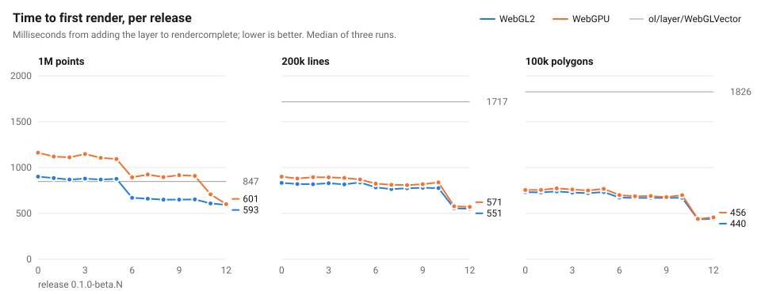

# ol-webgpu

[](https://github.com/jeroenvheel/ol-webgpu/actions/workflows/ci.yml)
[](https://www.npmjs.com/package/ol-webgpu)

WebGL2 and WebGPU vector layers for [OpenLayers](https://openlayers.org), with
a Rust/WebAssembly geometry core.

```js
import {GpuVectorLayer} from 'ol-webgpu';

const layer = new GpuVectorLayer({
  source: vectorSource, // any ol/source/Vector
  style: {
    'circle-radius': ['get', 'size'],
    'circle-fill-color': ['match', ['get', 'kind'], 0, '#1b9e77', '#d95f02'],
    'stroke-color': '#333',
    'stroke-width': 1.5,
    'fill-color': '#4a90d955',
  },
  variables: {minSize: 2},
});
map.addLayer(layer);
```

- **Same styles as `ol/layer/WebGLVector`**: flat styles, rules with
  `filter`/`else`, expressions and `variables`, compiled by ol's own shader
  builder, so a layer looks the same as ol's.
- **Faster**: against ol's layer the first render of 200 000 lines is 3×
  sooner and a frame more than 20× shorter. See [Benchmark](#benchmark).
- **Labels on the GPU**, with the fonts of the page, decluttered and
  hit-detectable. See [Labels](#labels).
- **Hit detection that works on WebGPU**, honours `hitTolerance` and
  respects `filter`.

## Installation

The package is on npm as [ol-webgpu](https://www.npmjs.com/package/ol-webgpu).

```sh
npm install ol-webgpu@next ol@10.11
```

This is a beta (`next` tag). `ol` is a peer dependency pinned to 10.11.x,
because the package uses non-API ol modules.

The package loads a worker and two wasm files next to itself. Vite copies
them for you; Angular needs two lines of configuration. That, the Content
Security Policy the package needs, and a stub for Jest are in
[docs/bundlers.md](docs/bundlers.md).

## Layers

| Layer | Backend |
|---|---|
| `GpuVectorLayer` | WebGPU where available, else WebGL2 (also at runtime, if no WebGPU device can be created). Option `backend`: `'auto'` (default), `'webgpu'` or `'webgl2'`. |
| `WebGPUVectorLayer` | WebGPU only |
| `WebGL2VectorLayer` | WebGL2 only |

`prepareWebGPU()` starts WebGPU ahead of the first layer, for a page that
makes its layers late; `isWebGPUAvailable()` tells whether the browser has
it.

## Options

Options and methods mirror `ol/layer/WebGLVector`: `source`, `style`,
`variables`, `updateStyleVariables()`, `setStyle()`, `disableHitDetection`,
`background`, and what every ol layer has. On top of those:

| Option | Default | |
|---|---|---|
| `text` | `'gpu'` | `'gpu'` draws `text-*` styles from a glyph atlas; `'canvas'` draws them with ol's text worker, exactly as `ol/layer/WebGLVector` does. See [Labels](#labels). |
| `declutter` | `false` | `true`, or a group name shared by several layers: labels do not overlap. |
| `renderOrder` | | A function that compares two features, as for ol's Canvas vector layer. A `z-index` in the style goes before it and orders the features too: with a `z-index` that is an expression, the fills, strokes and symbols of one number are drawn before those of the next, for up to 64 different numbers; with more the layer says so in the console and draws them kind by kind. Without a `z-index`, a layer of up to 4096 features draws them feature by feature in the order of `renderOrder`, as a Canvas layer does, where that takes no more than 64 steps; else kind by kind (fills, strokes, symbols), each in that order. |
| `antialias` | `false` | Multisampling. `false` matches ol pixel for pixel. |
| `smoothFill` | `false` | Fills without a stroke fade out over one pixel outside the polygon instead of ending in stairs, at about the cost of a stroke ([bench/fixes-2026-11-24.md](bench/fixes-2026-11-24.md)). |
| `updateWhileAnimating`, `updateWhileInteracting` | `false` | As for ol's vector layers: the source is asked for the features of the view also while the view moves. |
| `keepBuffers` | up to 32 MB | WebGL2 only. A copy of the buffers is kept in memory, to upload again at once after a lost context or when the layer moves to another canvas. By default for layers with up to 32 MB of buffers; a larger layer is built again in those cases (as long as its first build, and not drawn meanwhile). `true` keeps the copy whatever the size, `false` never. |
| `preserveDrawingBuffer` | `true` | Needed for map export. |
| `wasmUrl`, `shaderWasmUrl` | | Where the wasm files are, if not next to the module. |

A layer that is taken from its map (`map.removeLayer()`, `setMap(null)`), or
whose map is taken from the page (`map.setTarget(null)`, `map.dispose()`),
gives up its GPU buffers, its part of the shared canvas and its hit index by
itself, and builds them again when it is drawn again. A layer that is put
back in the same task, to move it in the layers, and a map that gets another
target in the same task keep them. The same goes for a map whose element is
taken from the page without telling the map: its layers let go of what they
hold on the GPU, and build it again when the element is back. (ol itself
keeps such a map, with its layers and features, until `map.setTarget(null)`
or `map.dispose()`.)

## Labels

```js
new GpuVectorLayer({
  source,
  style: {
    'circle-radius': 4,
    'circle-fill-color': '#b03a2e',
    'text-value': ['get', 'name'],
    'text-font': 'bold 13px "Open Sans", sans-serif', // fonts of the page work
    'text-fill-color': '#1c2833',
    'text-stroke-color': '#ffffff',
    'text-stroke-width': 3,
    'text-offset-y': -12,
  },
  declutter: true, // or a group name shared by several layers
});
```

The layer draws its labels itself: each glyph once into an atlas, with the
page's web fonts and at the device pixel ratio, then as instanced quads in
every world copy. Positions follow ol's Canvas text renderer (alignment,
several lines, backgrounds, polygon labels, text along lines), and upright
text is the same pixel for pixel as in `ol/layer/Vector`. With
`declutter`, labels that would overlap one with a higher priority are
hidden, and labels fade in and out.

How the atlas, the layout, decluttering and `text-max-width` work is in
[docs/labels.md](docs/labels.md).

## How it works

```
ol/source/Vector ──► FeatureBatch ──────► render instructions      (main thread)
                                              │
                                              ▼  transferred
                              worker: Rust/WASM (crates/core)
                              ├─ point / line / polygon buffers (earcut)
                              └─ packed Hilbert R-tree for hit detection
                                              │
              ┌───────────────────────────────┴─────────────────────────┐
              ▼                                                         ▼
   WebGL2VectorRenderer                                     WebGPUVectorRenderer
   ol's GLSL shaders as-is                     ol's GLSL ─► naga (Rust/WASM, crates/shader) ─► WGSL
   VAOs, instancing, u32 indices                          one pipeline per pass, MSAA optional
```

- **Same shaders and buffers as ol.** Styles are compiled by ol's
  `ShaderBuilder`; WebGPU gets the GLSL translated to WGSL by naga. The
  buffers are a Rust port of ol's, checked against ol's JS.
- **Buffers are built for the features, not for the view.** They are built
  again when features change, not each time the view comes to rest.
- **Off the main thread.** A worker tessellates and builds the hit index;
  the render instructions are made on the main thread in slices of 6 ms.
- **CPU hit detection** with a spatial index, because WebGPU readback is
  asynchronous and OpenLayers asks for hits synchronously.
- **Shared canvases, like ol**, so a map with many layers stays within the
  browser's limit of WebGL contexts.
- **Fallbacks**: WebGL2 without WebGPU, ol's JS buffer code without
  WebAssembly, the main thread without a worker.

Each of these, and what happens with style images, another source, a
background and a build that fails, is in
[docs/how-it-works.md](docs/how-it-works.md).

## Benchmark

1M points, 200k lines and 100k polygons, one layer, all features in view.
Milliseconds, lower is better; 0.1.0-beta.14 on an AMD Radeon R9 200.

| Data set | | ol WebGLVector | WebGL2 | WebGPU |
|---|---|---|---|---|
| 1M points | first render | 847 | 625 | **594** |
| | frame | 47.8 | 12.4 | **11.2** |
| 200k lines | first render | 1717 | **563** | 570 |
| | frame | 359.8 | 15.1 | **14.4** |
| 100k polygons | first render | 1826 | **454** | 473 |
| | frame | 237.9 | 11.6 | **11.3** |



Since the first release the first render became 31–49% shorter. The numbers
per release, memory, picking, labels, other GPUs and what it all shows are in
[docs/benchmark.md](docs/benchmark.md).

## Limitations

The ones to know before you start; all of them are in
[docs/limitations.md](docs/limitations.md).

- The peer dependency is pinned to ol 10.11.x, because the package depends
  on non-API ol modules.
- `['zoom']` cannot be used in `text-*` expressions (use `['resolution']`),
  and gradient and pattern fills for text are not supported.
- Labels are drawn after the geometries of their own layer, so a higher
  layer's geometries cover them.
- Hit detection is geometric: dash gaps and transparent icon pixels still
  count as hits.
- With `text: 'canvas'` labels have the limitations of ol's text worker: no
  web fonts of the page, not hit-detectable, no decluttering.
- The shader translator is about 1.3 MB of wasm, loaded once and only by the
  WebGPU layer.

## Development and tests

```sh
npm install
npx playwright install chromium
npm run build:wasm
npm run dev                   # examples on http://localhost:5180
npm test                      # unit tests
npm run test:rendering        # screenshots and hit detection in Chromium
```

All commands, the browser flags per platform, releasing and CI are in
[docs/development.md](docs/development.md).

All 19 upstream `WebGLVector` rendering cases of ol 10.11 pass on both
backends, with identical pixels on WebGL2 and WebGPU. What else is tested
(labels against ol's Canvas layer, hit detection, map export, shared
canvases, rebuilds, RenderFeatures, memory, the built package) is in
[docs/tests.md](docs/tests.md).
