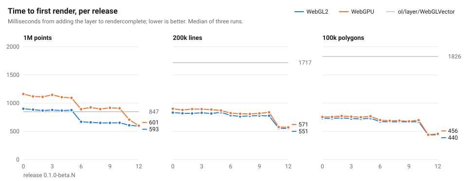
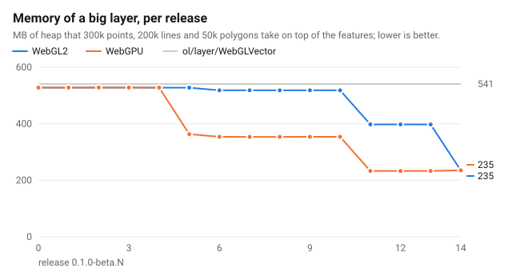

# Every release measured again (2026-11-26)

The benchmark of every release from 0.1.0-beta.0 to 0.1.0-beta.13, on one
machine on one day, so that the numbers can be put next to each other.
(beta.0 to beta.12 in the morning; beta.13 in the evening of the same day,
after it was released, from `main` at its tag:
[beta13-2026-11-26.md](beta13-2026-11-26.md); beta.14 the morning after:
[beta14-2026-11-27.md](beta14-2026-11-27.md).) The
reports of the releases themselves were made on different days, and partly
on another machine.

Each tag in a worktree of its own, with the wasm of its own Rust sources
(four different ones over the thirteen tags) and the runner of today
(`bench/run.js`; the page, `examples/bench.ts`, measures the same in all
of them). `npm run bench -- --layers=webgl2,webgpu`, three runs per
release, one after the other, 15 seconds apart, 7.6–9.4 GB of 16 GB free.
ol's own layer (`--layers=ol`, ol 10.11.0) twice at the end. AMD Radeon R9
200 Series, D3D11, Playwright Chromium 159, headless.

The numbers are in [history.json](history.json); `node bench/chart.js`
draws [first-render.svg](first-render.svg) from them.

## Time to first render

Milliseconds from adding the layer to `rendercomplete`, median of three
runs. 1M points, 200k lines, 100k polygons.

| Release | Points WebGL2 | Points WebGPU | Lines WebGL2 | Lines WebGPU | Polygons WebGL2 | Polygons WebGPU | What changed |
|---|---|---|---|---|---|---|---|
| beta.0 | 901 | 1162 | 833 | 901 | 731 | 755 | first release |
| beta.1 | 885 | 1120 | 821 | 880 | 729 | 756 | release workflow only |
| beta.2 | 869 | 1111 | 818 | 895 | 740 | 773 | labels on the GPU |
| beta.3 | 879 | 1147 | 829 | 893 | 728 | 760 | labels drawn in order |
| beta.4 | 869 | 1106 | 816 | 887 | 721 | 750 | builds in the worker with one copy |
| beta.5 | 877 | 1093 | 838 | 870 | 733 | 767 | own hit index per layer, buffers used again |
| beta.6 | 670 | 893 | 784 | 824 | 672 | 700 | buffers follow the features, attributes kept per feature |
| beta.7 | 660 | 924 | 765 | 812 | 669 | 686 | setSource, style images, worker failure |
| beta.8 | 650 | 896 | 774 | 809 | 669 | 690 | z-index and renderOrder, label fades in the shader |
| beta.9 | 650 | 917 | 779 | 818 | 670 | 678 | a layer without a map gives up its renderer |
| beta.10 | 653 | 909 | 776 | 838 | 670 | 699 | z-index across fills, strokes and symbols |
| beta.11 | 609 | 708 | 555 | 578 | 436 | 440 | first frame before the hit index, own batch of features |
| beta.12 | 593 | 601 | 551 | 571 | 440 | 456 | shaders compiled and device requested ahead |
| beta.13 | 587 | 603 | 552 | 560 | 434 | 452 | labels laid out in steps, symbols fade, renderOrder across kinds |
| beta.14 | 625 | 594 | 563 | 570 | 454 | 473 | features into the batch in slices, buffers over 256 MB, no copy of large buffers on WebGL2 |

ol's `WebGLVector` layer: 847, 1717, 1826 ms (points, lines, polygons).

From beta.0 to beta.14: points −31% on WebGL2 and −49% on WebGPU, lines −32%
and −37%, polygons −38% and −37%. Three releases made the difference:

- **beta.6**: points 200 ms sooner, lines 45–55 ms, polygons 60–70 ms. The
  refs of the features come from the entries of the batch instead of ol's
  map of uids, and the attribute values are kept per feature.
- **beta.11**: lines and polygons 220–260 ms sooner, points 45 ms on WebGL2
  and 200 ms on WebGPU. The first frame does not wait for the hit index,
  a WebGPU layer builds while its device is requested, and the layer has
  its own batch of features.
- **beta.12**: points 107 ms sooner on WebGPU. The shaders are compiled
  while the buffers are built.

Between those the releases added what they are named for, at the same
speed: the first render never became slower by more than the runs of one
release differ (the largest step up is 36 ms, points on WebGPU in beta.3).

### The runs

| Release | Points WebGL2 | Points WebGPU | Lines WebGL2 | Lines WebGPU | Polygons WebGL2 | Polygons WebGPU |
|---|---|---|---|---|---|---|
| beta.0 | 955 / 875 / 901 | 1129 / 1162 / 1169 | 833 / 823 / 836 | 901 / 885 / 915 | 747 / 731 / 731 | 755 / 761 / 750 |
| beta.1 | 885 / 870 / 911 | 1120 / 1119 / 1120 | 822 / 816 / 821 | 895 / 880 / 864 | 747 / 729 / 724 | 752 / 763 / 756 |
| beta.2 | 877 / 869 / 866 | 1090 / 1111 / 1163 | 817 / 821 / 818 | 876 / 895 / 928 | 727 / 740 / 765 | 766 / 773 / 778 |
| beta.3 | 880 / 879 / 870 | 1147 / 1157 / 1138 | 829 / 880 / 825 | 893 / 988 / 880 | 728 / 728 / 766 | 772 / 760 / 750 |
| beta.4 | 878 / 869 / 851 | 1102 / 1117 / 1106 | 816 / 816 / 815 | 887 / 886 / 893 | 718 / 721 / 725 | 741 / 772 / 750 |
| beta.5 | 892 / 877 / 869 | 1093 / 1168 / 1082 | 838 / 841 / 834 | 870 / 876 / 869 | 738 / 733 / 719 | 771 / 746 / 767 |
| beta.6 | 670 / 663 / 719 | 906 / 893 / 889 | 784 / 768 / 797 | 839 / 818 / 824 | 672 / 665 / 697 | 700 / 694 / 708 |
| beta.7 | 664 / 660 / 659 | 910 / 924 / 950 | 767 / 764 / 765 | 808 / 820 / 812 | 673 / 668 / 669 | 709 / 678 / 686 |
| beta.8 | 687 / 646 / 650 | 905 / 896 / 890 | 769 / 774 / 775 | 809 / 807 / 810 | 667 / 699 / 669 | 690 / 707 / 688 |
| beta.9 | 649 / 655 / 650 | 902 / 917 / 933 | 777 / 779 / 782 | 819 / 818 / 808 | 670 / 680 / 667 | 678 / 678 / 678 |
| beta.10 | 654 / 653 / 651 | 901 / 909 / 945 | 776 / 776 / 774 | 816 / 838 / 842 | 682 / 670 / 669 | 707 / 691 / 699 |
| beta.11 | 584 / 624 / 609 | 703 / 729 / 708 | 559 / 555 / 552 | 578 / 575 / 591 | 437 / 436 / 432 | 434 / 459 / 440 |
| beta.12 | 593 / 587 / 598 | 602 / 578 / 601 | 560 / 551 / 550 | 561 / 571 / 580 | 440 / 441 / 435 | 466 / 437 / 456 |
| beta.13 | 597 / 587 / 584 | 584 / 603 / 605 | 550 / 552 / 553 | 564 / 560 / 560 | 433 / 434 / 435 | 452 / 475 / 437 |
| beta.14 | 634 / 625 / 612 | 594 / 603 / 580 | 559 / 563 / 564 | 562 / 578 / 570 | 464 / 454 / 450 | 471 / 483 / 473 |

## Frames

Milliseconds per frame while the view moves, median of three runs.

| Release | Points WebGL2 | Points WebGPU | Lines WebGL2 | Lines WebGPU | Polygons WebGL2 | Polygons WebGPU |
|---|---|---|---|---|---|---|
| beta.0 | 12.6 | 12 | 15.1 | 15 | 11.4 | 11.6 |
| beta.1 | 12.6 | 11.6 | 15.5 | 14.8 | 11.4 | 11.5 |
| beta.2 | 12.6 | 11.8 | 15.2 | 14.7 | 12.4 | 12.5 |
| beta.3 | 12.6 | 11.5 | 15.3 | 15.3 | 11.6 | 11.3 |
| beta.4 | 12.9 | 11.9 | 15.4 | 15.4 | 12 | 12.1 |
| beta.5 | 12.6 | 11.5 | 15.6 | 14.8 | 12.4 | 12.1 |
| beta.6 | 12.7 | 11.4 | 14.4 | 13.9 | 11.2 | 11.6 |
| beta.7 | 12.4 | 11.9 | 15.7 | 15.5 | 11.8 | 12 |
| beta.8 | 12.8 | 11.3 | 15.5 | 14.8 | 12.1 | 12.1 |
| beta.9 | 12.6 | 11.7 | 15.5 | 15.1 | 12 | 12.2 |
| beta.10 | 12.6 | 11.9 | 15.5 | 15 | 12.1 | 12.3 |
| beta.11 | 12.5 | 11.6 | 15.4 | 15.3 | 12.1 | 12 |
| beta.12 | 12.4 | 11.4 | 15.3 | 15.1 | 11.9 | 11.7 |
| beta.13 | 12.4 | 11.4 | 15.3 | 14.4 | 11.8 | 11.6 |
| beta.14 | 12.4 | 11.2 | 15.1 | 14.4 | 11.6 | 11.3 |

ol's layer: 47.8, 359.8, 237.9 ms. Nothing changed over the releases: the
shaders and the buffers are the same.

## Picks

A pick takes 0.02–0.11 ms in every release (median of three runs of 200
picks each); the numbers are in `history.json`.

## Memory

Measured for every release on 28 November, on the same machine: the
JavaScript heap that a layer of 300 000 points, 200 000 lines and 50 000
polygons (the layer of `npm run test:memory -- --big`) adds to its features,
in MB. One page per release and backend: the features are made (609 MB), a
source and the layer are added, and the heap is read two and a half seconds
after `rendercomplete`, with the garbage collected before both readings.
One run each; repeated runs differ by 0.1 MB. Each tag in a worktree of its
own with the wasm of its own Rust sources, as for the times.

| Release | WebGL2 | WebGPU | What changed for memory |
|---|---|---|---|
| beta.0 | 528 | 528 |  |
| beta.1 | 528 | 528 |  |
| beta.2 | 528 | 528 |  |
| beta.3 | 528 | 528 |  |
| beta.4 | 528 | 528 |  |
| beta.5 | 528 | 363 | WebGPU keeps no copy of its buffers |
| beta.6 | 518 | 354 | the refs of the features without ol's map of uids |
| beta.7 | 518 | 354 |  |
| beta.8 | 518 | 354 |  |
| beta.9 | 518 | 354 |  |
| beta.10 | 518 | 354 |  |
| beta.11 | 398 | 233 | the layer's own batch of features instead of ol's |
| beta.12 | 398 | 233 |  |
| beta.13 | 398 | 233 |  |
| beta.14 | 235 | 235 | WebGL2 keeps no copy of buffers over 32 MB |
| ol/layer/WebGLVector | 541 | | |

175 MB of every number is ol's vector source (it listens to every feature),
the same in all releases: without it the layer went from 353 to 60 MB. The
steps are the ones the reports of the releases describe: beta.5 (WebGPU
without a copy of its buffers), beta.6 (10 MB: no map of uids), beta.11 (120
MB: the layer's own batch) and beta.14 (163 MB on WebGL2: no copy of large
buffers).

The same from the memory test as the releases reported it, which also has
RenderFeatures:

| | WebGL2 | WebGPU | WebGL2, RenderFeatures | WebGPU, RenderFeatures |
|---|---|---|---|---|
| beta.5 ([memory-2026-11-21.md](memory-2026-11-21.md)) | 528 | 364 | | |
| beta.10 ([beta10-2026-11-25.md](beta10-2026-11-25.md)) | 518 | 354 | 407 | 243 |
| beta.11 ([first-render-memory-2026-11-26.md](first-render-memory-2026-11-26.md)) | 398 | 233 | 280 | 116 |
| beta.12 ([beta12-2026-11-26.md](beta12-2026-11-26.md)) | 397 | 233 | 280 | 116 |
| beta.13 ([beta13-2026-11-26.md](beta13-2026-11-26.md)) | 398 | 233 | 280 | 116 |
| beta.14 ([beta14-2026-11-27.md](beta14-2026-11-27.md)) | 235 | 235 | 117 | 118 |
| beta.11 and later, `keepBuffers: false` | 233 | – | | |
