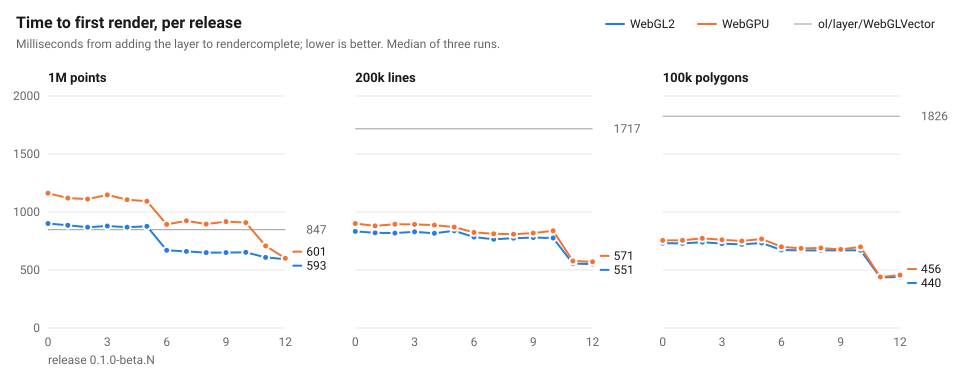

# Benchmark

`npm run bench -- --layers=ol,webgl2,webgpu` (examples/bench.html in
Playwright Chromium, AMD Radeon R9 200, D3D11, 1100×900 map, all features in
view, one layer). Milliseconds, lower is better. A frame is `renderSync()`
plus a 1-pixel readback of the canvas, so it includes the GPU work. The
numbers are those of 0.1.0-beta.13, the median of three runs (ol's layer:
two).

**End to end per layer**

| Data set | | ol WebGLVector | WebGL2 | WebGPU |
|---|---|---|---|---|
| 1M points | ready (add layer → rendercomplete) | 847 | **587** | 603 |
| | frame (pan, no rebuild) | 47.8 | 12.4 | **11.4** |
| | pick (`forEachFeatureAtPixel`) | 0.00 | 0.09 | 0.09 |
| 200k lines | ready | 1717 | **552** | 560 |
| | frame | 359.8 | 15.3 | **14.4** |
| | pick | 0.01 | 0.03 | 0.05 |
| 100k polygons | ready | 1826 | **434** | 452 |
| | frame | 237.9 | 11.8 | **11.6** |
| | pick | 0.01 | 0.03 | 0.07 |

**Per release**

Every release was built again and measured on the same machine on one day
([bench/history-2026-11-26.md](../bench/history-2026-11-26.md), numbers in
`bench/history.json`, chart by `node bench/chart.js`). Time to first render,
median of three runs:

| Release | Points WebGL2 | Points WebGPU | Lines WebGL2 | Lines WebGPU | Polygons WebGL2 | Polygons WebGPU | What changed for speed |
|---|---|---|---|---|---|---|---|
| beta.0 | 901 | 1162 | 833 | 901 | 731 | 755 | |
| beta.5 | 877 | 1093 | 838 | 870 | 733 | 767 | |
| beta.6 | 670 | 893 | 784 | 824 | 672 | 700 | the layer's refs instead of ol's uid map; attributes kept per feature |
| beta.10 | 653 | 909 | 776 | 838 | 670 | 699 | |
| beta.11 | 609 | 708 | 555 | 578 | 436 | 440 | the first frame does not wait for the hit index; the layer's own batch of features |
| beta.12 | 593 | 601 | 551 | 571 | 440 | 456 | shaders compiled and the device requested ahead |
| beta.13 | 587 | 603 | 552 | 560 | 434 | 452 | |
| beta.0 → beta.13 | −35% | −48% | −34% | −38% | −41% | −40% | |

Frame times did not change over the releases (11–13 ms for points and
polygons, 14–16 ms for lines, on both backends), nor did a pick.

The heap a big layer adds (300 000 points, 200 000 lines, 50 000 polygons,
`npm run test:memory -- --big`), in MB:

| | WebGL2 | WebGPU | WebGL2, RenderFeatures | WebGPU, RenderFeatures |
|---|---|---|---|---|
| beta.5 | 528 | 364 | | |
| beta.10 | 518 | 354 | 407 | 243 |
| beta.11 to beta.13 | 398 | 233 | 280 | 116 |
| the same, `keepBuffers: false` | 233 | – | | |
| after beta.13 (no copy of buffers over 32 MB by default) | 235 | 233 | | |

**Buffer generation (worker), ol's JS vs Rust/WASM**

| | ol JS | Rust/WASM |
|---|---|---|
| 200k lines | 1003 | **270** (3.7×) |
| 100k polygons (earcut) | 526 | **51** (10×) |
| hit index build, 1M points / 200k lines / 100k polygons | – | 167 / 56 / 29 |

What this shows:

- **Frames** are 20–24× faster than ol's layer for lines and polygons, and
  about 4× for points, with the same shaders and buffers. The gap is in how
  frames are drawn (ol renders into an offscreen framebuffer and copies it,
  among other things); it has not been profiled further.
- **Time to first render** is 3× shorter than ol's for lines, 4× for
  polygons and 1.4× for points. The tessellation is Rust's, the features are
  read into typed arrays of the layer's own instead of ol's
  `MixedGeometryBatch`, and the first frame waits for neither the hit index
  nor, on WebGPU, the shaders.
- **WebGPU and WebGL2 are level** on this GPU since beta.12, for the first
  frame and for the frames after it. On other GPUs they are not: on an Intel
  Iris Xe a frame of a million points takes 87 ms on WebGL2 and 24 ms on
  WebGPU, and on an NVIDIA T550 WebGPU draws lines and polygons faster
  ([bench/beta12-2026-11-26.md](../bench/beta12-2026-11-26.md)).
- **Picking** costs about 0.1 ms or less, like ol's GPU readback, but works
  on WebGPU and is correct in the two cases where ol's is not. The first
  pick after a rebuild is slower (a few ms, up to about 50 ms for 1M
  points) while feature-dependent sizes are still being measured.
- Point buffers are a plain copy, so WASM gains nothing there.
- This benchmark has one layer. On maps with many layers, the shared
  canvases matter more: on a real map with 24 vector layers (660k
  features, Intel Iris Xe, 60 Hz), zooming with the whole map in view ran
  at 16 fps with ol's layers, 18 fps with WebGL2 and 29 fps with WebGPU
  (measured with an early release).

**Labels** (`examples/labels.html`: country names and random place names,
1100×900 map, decluttered, AMD Radeon R9 200, Chromium). A frame is
`renderSync()` while panning:

| Places | | ol Canvas layer | GPU text |
|---|---|---|---|
| 20 000 (5 900 in view) | frame while panning | 20 | **0.9** |
| | label layout after a zoom | (in the frame) | 34, over 3 frames |
| 200 000 (59 000 in view) | frame while panning | 168 | **4.8** |
| | label layout after a zoom | (in the frame) | 280, over 26 frames |
| | worst frame while panning | 330 | 15 |

The Canvas layer lays out and declutters all labels in every frame; GPU
text measures them once per layout, gives glyphs to the 1 700 to 2 300 that
can win a place, and declutters those per frame (0.4 ms). A layout is made
in steps of at most 10 ms a frame (4 ms while the view moves): collecting
the features of the area, measuring them, choosing the labels that can win a
place, and laying those out. Up to 0.1.0-beta.12 the first and the third of
those were done in one go each, and the worst frame was 121 ms.

[Back to the README](../README.md)
